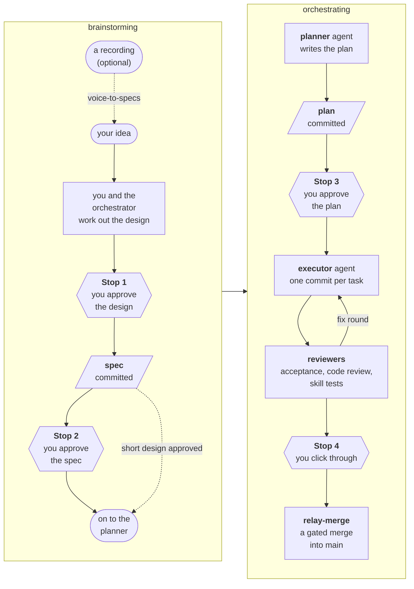

# hyper-relay

<p align="center">
  
</p>

**A relay for coding agents: one idea, handed cleanly from brainstorm to merge.**

hyper-relay is a set of skills for [Claude Code](https://code.claude.com) and [OpenCode](https://opencode.ai) that
turns "build me X" into a disciplined pipeline. It covers brainstorming, a written spec, an implementation plan,
execution in isolation, a review by clicking through the running app, and a merge you decide on. Each stage hands a
written artefact to the next, the way a relay team hands over the baton. Nothing is carried in anyone's head, and the
last leg is always yours.

It is a hard fork of [obra/superpowers](https://github.com/obra/superpowers) (v5.1.0), reshaped around one way of
working: an orchestrating session that you talk to, role agents that do the legwork, and a board that knows where
everything stands.

> **Status: 0.2.2.** The skills, the role agents, per-repo configuration, the orchestrator (several plans at once
> included), `wt` and `relay-merge` are in. 
## The relay



Hexagons are your stops: the relay never passes one without your answer. Rectangles are the work (in `orchestrating`,
each leg by a fresh agent), and slanted boxes are the files handed from leg to leg.

| Leg | Skill | Hands over |
|---|---|---|
| Capture | `voice-to-specs` | Briefs or board cards from a recording. It stops there and never writes specs, plans or code. |
| Design | `brainstorming` (+ `visual-companion` for mockups) | An approved design, written as a spec in `docs/superpowers/specs/`, read first by a builder check |
| Plan | `writing-plans`, run by a planner agent | `docs/superpowers/plans/YYYY-MM-DD-<feature>.md`: every task with its files, its tests and the decisions the executor cannot make alone (signatures, the spec's values, skill text in full), and a binding contract between plans |
| Execute | `executing-plans`, `using-git-worktrees`, `test-driven-development` | Commits, one per task, on a branch or in a worktree |
| Review | the acceptance reviewer agent, `requesting-code-review` (one review per branch), `receiving-code-review`, `verification-before-completion`, and the skill tests (`writing-skills`' RED/GREEN runs) | Evidence that it works: the plan's acceptance steps, one code review of the whole branch, each skill test when a plan changes a skill, then your click-through |
| Finish | `relay-merge`, run by the orchestrator (`finishing-a-development-branch` for work outside the relay) | A `--no-ff` merge into `main`, gated by the repo's `.hyper-relay/merge.conf`, on your call |

`orchestrating` runs the legs from an approved spec to the merge: it dispatches the planner, the executor and the
reviewers, checks what each hands back, and stops for you at four points (the design, the spec, the plan and the
merge). Each agent writes its full report to the plan's run folder (`.hyper-relay/runs/<branch>/`, ignored by git) and
hands back a short summary, and the orchestrator reads a plan through `relay-plan`, never whole. No check runs twice
before the merge: the executor's gates are saved to a log the orchestrator reads, and `relay-merge` runs them once
more on the merged result. A finding that still fails after the repo's fix-round cap (two rounds unless
`.hyper-relay/agents.md` sets `fix-rounds`) becomes a card instead of another round.

Several plans can be in flight at once, each in its own worktree. Before each dispatch, the orchestrator's
`parallel.md` checks them for shared files and clashing numbered names: a plan that shares files with another waits
for it, and one whose migration number clashes is renumbered. A plan that builds on another is stacked on its branch,
and every branch lands through `relay-merge`. When a plan changes a skill, the orchestrator also runs its skill tests
beside the code review: each pressure scenario on `main`'s skills (RED) and on the branch's (GREEN), as
`writing-skills` teaches.

Also in the box: `systematic-debugging` (root cause before any fix), `dispatching-parallel-agents`, `writing-skills`,
`using-hyper-relay` (how to find and use the skills) and `agents` (generates each repo's planner, executor and reviewer
agents from hyper-relay's templates and the repo's own `.hyper-relay/agents.md`).

### The rules of the relay

- **A gate between every leg.** Each phase ends with your approval, and the next one never starts in the same breath.
- **Hand-offs are files, not memory.** A spec, a plan, a commit or a report. If it isn't written down, it wasn't handed
  over.
- **Acceptance is by clicking.** A green test suite is necessary, not sufficient.
- **Root causes only.** No band-aids, and no "it passes when run alone".

## Quartz: the board

hyper-relay is designed to run alongside Quartz, a project board built for exactly this pipeline (not public yet).

With Quartz connected:

- **Every spec and plan names its card(s)** in its header (`**Card:**` / `**Cards:**`), and committing the file uploads
  it to them.
- **Plan tasks tick themselves.** The commit that finishes a task carries a `Plan-Task: <plan>#<n>` trailer, and a git
  hook ticks that task on the board.
- **Cards move with the work:** brainstorming, In progress (`quartz link-branch`), In review (`quartz review`), and
  merged (a git hook).
- **The board holds the state.** Each card's status says where each of its plans stands, what comes next and which
  agents are running, and your decisions go on it as notes as you make them. You can clear the conversation at any
  moment without asking for notes first: a fresh session picks up from the board.
- **Issues found on the way become proposed cards,** labelled `proposed` and filed by the agent that found them, for
  you to prune on the board.

Without Quartz, nothing breaks. Every Quartz step falls back to plain Markdown and files (a plan's status and its
proposed cards go to its run folder), and the skills work on their own. But the board is half the point: it is what
lets a long-running, multi-agent pipeline stay legible.

When the `quartz` CLI is installed but a repo is not connected yet, the relay sets the repo up itself and asks you
only for the steps that are yours: a project, a token and the repo's name. `git config hyper-relay.quartz off` turns
that off in a repo, and `git config --unset hyper-relay.quartz` turns it back on.

## Install

### Claude Code

```text
/plugin marketplace add alexvtejeda/hyper-relay
/plugin install hyper-relay@hyper-relay
```

Skills appear as `hyper-relay:<skill>`, for example `hyper-relay:brainstorming`.

- **The repo is public,** so installing and updating need no GitHub credentials.
- **Updating:** `claude plugin update hyper-relay@hyper-relay`, then `/reload-plugins` in a running session (or start
  a new one). `plugin.json` pins the version, and every change to what the plugin ships raises it, so an update brings
  each change and nothing half-done. Claude Code checks a marketplace that is not Anthropic's in the background only
  if you turn on auto-update for it (`/plugin`, then **Marketplaces**).
- **Install from GitHub, not from a local clone.** A local-directory marketplace loads files in place, gitignored ones
  included, so a developer's local `.mcp.json` would load as the plugin's own MCP servers.

### OpenCode

Clone the repo, then point OpenCode's `skills` setting at its `skills/` folder in `~/.config/opencode/opencode.json`:

```json
{
  "skills": ["/path/to/hyper-relay/skills"]
}
```

Use an absolute path: OpenCode resolves a relative one from its working directory. Skills from an explicit `skills`
entry take precedence over same-named skills OpenCode finds elsewhere (it also reads `~/.claude/skills/`). Update with
`git pull` on the clone's `main`.

### voice-to-specs

It needs Python 3.10+ and ffmpeg. The first transcription runs its `scripts/setup.sh`, which builds a Python venv with
whisper under `${XDG_DATA_HOME:-~/.local/share}/hyper-relay/voice-to-specs/`, outside the plugin, so updates never
delete it. Whisper runs on the CPU: `setup.sh` installs CPU-only torch first, because PyPI's default CUDA build crashes
under WSL.

### wt

`wt` (`bin/wt`) gives each git worktree a disposable Docker Compose stack, so a branch can be clicked through beside
your real stack. Once the plugin is installed, Claude Code's Bash tool finds it by name: a plugin's `bin/` is on that
tool's `PATH`. For your own shell, or a Makefile that calls `wt`, symlink it from a clone into a directory on your
`PATH`:

```sh
ln -sfn /path/to/hyper-relay/bin/wt ~/.local/bin/wt
```

Each project that uses it commits a short `.wt.conf`. [docs/wt.md](docs/wt.md) says what to put in it, what `wt`
needs (dash, Docker Compose 2.24.4 or later, `jq`, `ss`) and what each command does.

### relay-merge

`relay-merge` (`bin/relay-merge`) is how the relay lands a branch: it merges each branch it is given into `main` with
`--no-ff`, runs the gates the repo's `.hyper-relay/merge.conf` names on the merged result, and removes the branch and
its worktree. Claude Code's Bash tool finds it by name, as it finds `wt`. For your own shell, symlink it the same way:

```sh
ln -sfn /path/to/hyper-relay/bin/relay-merge ~/.local/bin/relay-merge
```

[docs/relay-merge.md](docs/relay-merge.md) says what goes in `merge.conf` and what each exit code means.

## Credits

hyper-relay stands on [superpowers](https://github.com/obra/superpowers) by Jesse Vincent and contributors. Most of
its skills began there, and its design philosophy (skills as tested, composable process) is theirs. obra's repo stays
this one's `upstream`, and fixes from it are ported by hand.

## License

MIT. See [LICENSE](LICENSE), which keeps the original superpowers copyright notice.
