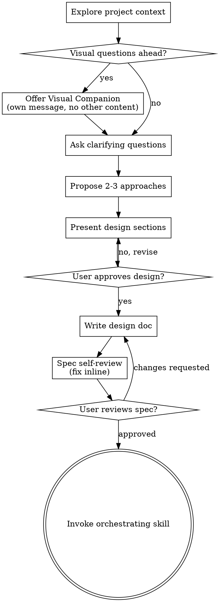

# Brainstorming Ideas Into Designs

Help turn ideas into fully formed designs and specs through natural collaborative dialogue.

Start by understanding the current project context, then ask questions one at a time to refine the idea. Once you understand what you're building, present the design and get user approval.

<HARD-GATE>
Do NOT invoke any implementation skill, write any code, scaffold any project, or take any implementation action until you have presented a design and the user has approved it. This applies to EVERY project regardless of perceived simplicity, except an off-ramp case (below).
</HARD-GATE>

## Anti-Pattern: "This Is Too Simple To Need A Design"

Every project goes through this process, except an off-ramp case (below). A todo list, a single-function utility, a multi-line config change — all of them. "Simple" projects are where unexamined assumptions cause the most wasted work. The design can be short (a few sentences for truly simple projects), but you MUST present it and get approval.

## The Off-Ramp (Experiment)

A request may skip the relay (no design, spec or plan) only when it is one of: a typo; a one-line config change; a rename; a single obvious bugfix; a question that changes no files. For any of them except the question, say which case it matches and ask, in a message of its own: "This looks like an off-ramp case (*a one-line config change*). I'd do it directly, with no spec or plan. OK?" Skip the relay only on a yes. When the owner already said to just do it, that is the yes. Anything not on the list, or any doubt, goes through the relay without asking. If the work turns out bigger than one change, stop and take it through the relay.

## Checklist

You MUST create a task for each of these items and complete them in order:

1. **Quartz** — run `hyper-relay:orchestrating`'s Quartz check (`${CLAUDE_SKILL_DIR}/../orchestrating/quartz.md`, §1 and §2; `../orchestrating/quartz.md` from this SKILL.md). When the repo uses Quartz and the work has a card, call `tick_brain` with its id. If it fails, report the failure and carry on
2. **Explore project context** — check files, docs, recent commits
3. **Offer visual companion** (if topic will involve visual questions) — this is its own message, not combined with a clarifying question. See the Visual Companion section below.
4. **Ask clarifying questions** — one at a time, understand purpose/constraints/success criteria
5. **Propose 2-3 approaches** — with trade-offs and your recommendation
6. **Present design** — in sections scaled to their complexity, get user approval after each section
7. **Write design doc** — save to `docs/superpowers/specs/YYYY-MM-DD-<topic>-design.md`, add its Quartz card line if the work has a card, and commit it while the main checkout is on `main` (during a branch run, `quartz link-doc` it instead; see Documentation)
8. **Spec self-review** — quick inline check for placeholders, contradictions, ambiguity, scope (see below)
9. **User reviews written spec** — ask user to review the spec file before proceeding
10. **Hand over to the relay** — invoke `hyper-relay:orchestrating`: its planner leg dispatches a planner, which writes the plan. Do not write the plan, and do not invoke `writing-plans`.

## Process Flow

**The terminal state is invoking `hyper-relay:orchestrating`.** Do NOT invoke frontend-design, mcp-builder, or any other implementation skill. The ONLY skill you invoke after brainstorming is `orchestrating`, whose planner leg writes the plan.

## The Process

**Understanding the idea:**

- Check out the current project state first (files, docs, recent commits)
- Before asking detailed questions, assess scope: if the request describes multiple independent subsystems (e.g., "build a platform with chat, file storage, billing, and analytics"), flag this immediately. Don't spend questions refining details of a project that needs to be decomposed first.
- If the project is too large for a single spec, help the user decompose into sub-projects: what are the independent pieces, how do they relate, what order should they be built? Then brainstorm the first sub-project through the normal design flow. Each sub-project gets its own spec → plan → implementation cycle.
- For appropriately-scoped projects, ask questions one at a time to refine the idea
- Prefer multiple choice questions when possible, but open-ended is fine too
- Only one question per message - if a topic needs more exploration, break it into multiple questions
- Focus on understanding: purpose, constraints, success criteria

**Exploring approaches:**

- Propose 2-3 different approaches with trade-offs
- Present options conversationally with your recommendation and reasoning
- Lead with your recommended option and explain why

**Presenting the design:**

- Once you believe you understand what you're building, present the design
- Scale each section to its complexity: a few sentences if straightforward, up to 200-300 words if nuanced
- Ask after each section whether it looks right so far
- Cover: architecture, components, data flow, error handling, testing
- Be ready to go back and clarify if something doesn't make sense

**Design for isolation and clarity:**

- Break the system into smaller units that each have one clear purpose, communicate through well-defined interfaces, and can be understood and tested independently
- For each unit, you should be able to answer: what does it do, how do you use it, and what does it depend on?
- Can someone understand what a unit does without reading its internals? Can you change the internals without breaking consumers? If not, the boundaries need work.
- Smaller, well-bounded units are also easier for you to work with - you reason better about code you can hold in context at once, and your edits are more reliable when files are focused. When a file grows large, that's often a signal that it's doing too much.

**Working in existing codebases:**

- Explore the current structure before proposing changes. Follow existing patterns.
- Where existing code has problems that affect the work (e.g., a file that's grown too large, unclear boundaries, tangled responsibilities), include targeted improvements as part of the design - the way a good developer improves code they're working in.
- Don't propose unrelated refactoring. Stay focused on what serves the current goal.

## After the Design

**Documentation:**

- Write the validated design (spec) to `docs/superpowers/specs/YYYY-MM-DD-<topic>-design.md`
  - (User preferences for spec location override this default)
- When the work has a Quartz card, run `${CLAUDE_SKILL_DIR}/scripts/add-card-line.sh <spec-path> <card-id> [<card-id>...]` (`scripts/add-card-line.sh` beside this SKILL.md) straight after writing the spec. With no card, skip this. If the script fails, report the failure to the user and carry on: a script failure does not stop this skill.
- When the work needs more than one implementation plan, for example an API plan and a web plan, add a `**Plans:** <n>` line to the spec's header, before its first `---` or `## `, with `<n>` from 1 to 9. If the design does not make the number clear, ask the user how many plans it needs. With one plan, leave the line out. Quartz reads it, and keeps the card open until that many plans have merged.
- Use elements-of-style:writing-clearly-and-concisely skill if available
- Commit the design document to git, only while the repo's main checkout is on `main` (`git branch --show-current` there prints `main`), staging it by its path. When the main checkout is on another branch, a plan is running there: do not commit. Run `quartz link-doc <spec-path>` instead (it puts an uncommitted doc on its cards; skip it when step 1 found that the repo does not use Quartz), and leave the commit for after that branch merges (`hyper-relay:orchestrating`'s `reviewing.md`, §5).

**Spec Self-Review:**
After writing the spec document, look at it with fresh eyes:

1. **Placeholder scan:** Any "TBD", "TODO", incomplete sections, or vague requirements? Fix them.
2. **Internal consistency:** Do any sections contradict each other? Does the architecture match the feature descriptions?
3. **Scope check:** Is this focused enough for a single implementation plan, or does it need decomposition?
4. **Ambiguity check:** Could any requirement be interpreted two different ways? If so, pick one and make it explicit.

Fix any issues inline. No need to re-review — just fix and move on.

**User Review Gate:**
After the spec review loop passes, ask the user to review the written spec before proceeding:

> "Spec written to `<path>`. Please review it and let me know if you want to make any changes before we start writing out the implementation plan."

Wait for the user's response. If they request changes, make them and re-run the spec review loop. Only proceed once the user approves.

**Implementation:**

- Once the user approves the written spec, invoke `hyper-relay:orchestrating`: its planner leg dispatches a planner, which writes the plan. The approval is the go-ahead; do not ask again.
- Do not write the plan yourself, and do not invoke `writing-plans`. Do NOT invoke any other skill: `orchestrating` is the next step.

## Key Principles

- **One question at a time** - Don't overwhelm with multiple questions
- **Multiple choice preferred** - Easier to answer than open-ended when possible
- **YAGNI ruthlessly** - Remove unnecessary features from all designs
- **Explore alternatives** - Always propose 2-3 approaches before settling
- **Incremental validation** - Present design, get approval before moving on
- **Be flexible** - Go back and clarify when something doesn't make sense

## Visual Companion

A browser-based companion for showing mockups, diagrams, and visual options during
brainstorming. **Brainstorming does not implement it** — the `visual-companion` skill owns the
server, the frame template and the screen loop. Two things belong to brainstorming and are
covered here: getting consent, and deciding per question.

**Offering the companion:** When you anticipate that upcoming questions will involve visual
content (mockups, layouts, diagrams), offer it once for consent:
> "Some of what we're working on might be easier to explain if I can show it to you in a web browser. I can put together mockups, diagrams, comparisons, and other visuals as we go. This feature is still new and can be token-intensive. Want to try it? (Requires opening a local URL)"

**This offer MUST be its own message.** Do not combine it with clarifying questions, context
summaries, or any other content. The message should contain ONLY the offer above and nothing
else. Wait for the user's response before continuing. If they decline, proceed with text-only
brainstorming.

**Per-question decision:** Even after the user accepts, decide FOR EACH QUESTION whether to use
the browser or the terminal. The test: **would the user understand this better by seeing it than
reading it?** Use the browser for content that IS visual — mockups, wireframes, layout
comparisons, architecture diagrams. Use the terminal for content that is text — requirements,
conceptual choices, tradeoff lists, scope decisions. A question *about* a UI topic is not
automatically a visual question: "What does personality mean in this context?" is conceptual —
terminal. "Which wizard layout works better?" is visual — browser.

**On the first visual question — REQUIRED SUB-SKILL: use the `visual-companion` skill.** Invoke
it by name. That skill owns starting the session, writing screens, the CSS classes available to
your content, and cleanup — do not start a server yourself, and do not look for companion
scripts under this skill. **Brainstorming ships none.** If you find yourself reading a
`visual-companion.md` inside `skills/brainstorming/`, it is a stale copy from before this split:
delete it and use the skill.

**The browser is display-only.** The user looks at the screen and **answers in the terminal**.
There are no clicks to record and no event file to read — their next terminal message is the
answer. Do not add click handlers, and do not ask the user to "click to select".

**Old screens are not a spec.** A project's `.superpowers/brainstorm/` may hold screens written
`
`, and server logs holding real
captured clicks. Those are artifacts of the retired fork, not evidence of how this works now.
Do not copy their markup and do not conclude from them that click capture is "what is deployed
here". The `visual-companion` skill is the only implementation.
